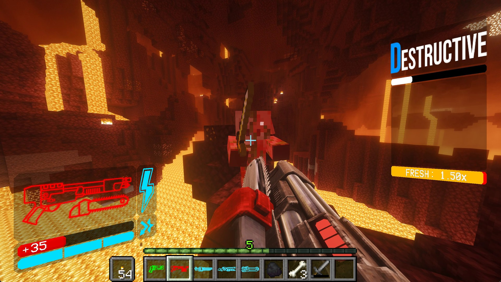
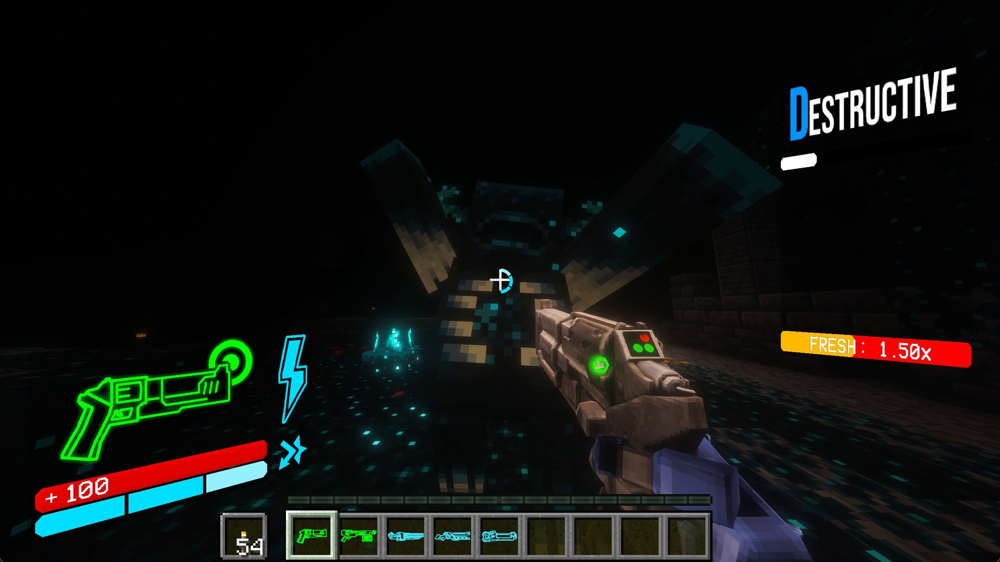
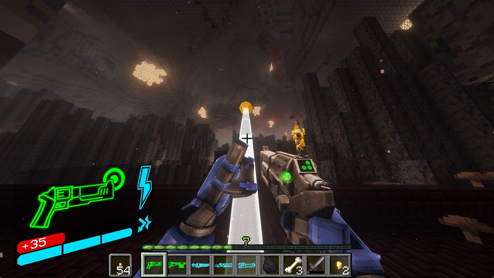
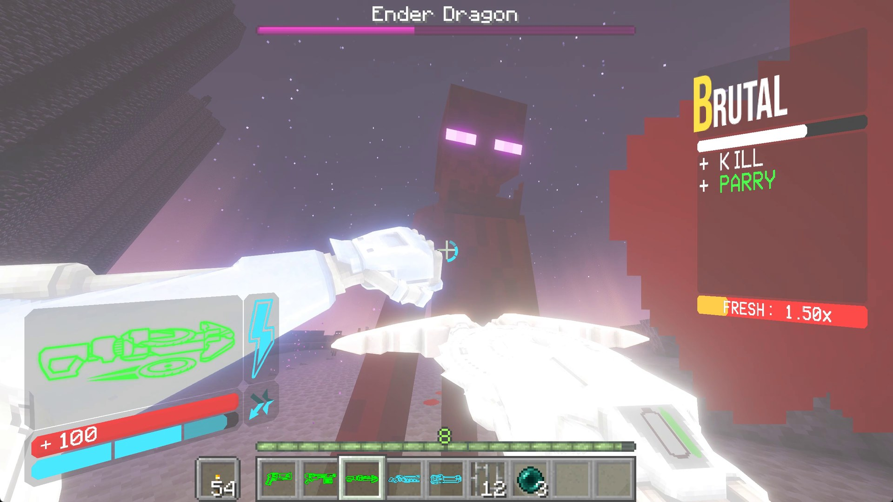
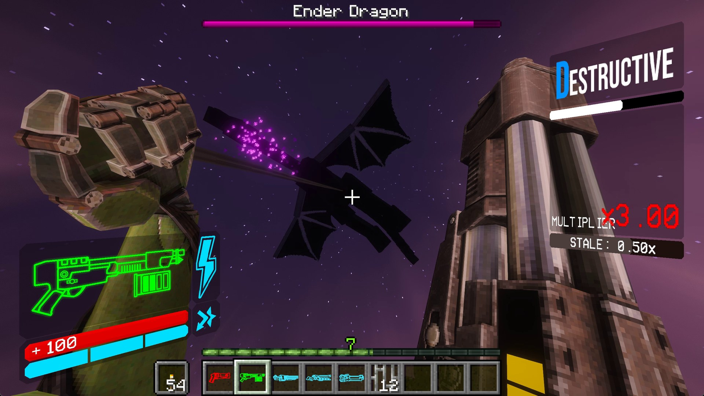

# UltraCraft Reimagined

ULTRAKILL inside Minecraft (Forge 1.20.1): you play as V1, with ULTRAKILL's own movement, animations, weapons and every
weapon variation including ULTRAKILL's own HUD, style meter and shop, all converted from your own copy of ULTRAKILL.

> **In beta testing.** No release yet: the setup is built and the first release follows the beta.

> **Unofficial fan mod.** Not affiliated with or endorsed by New Blood Interactive, Arsi "Hakita" Patala or Mojang.
> ULTRAKILL © New Blood Interactive. Minecraft © Mojang Studios / Microsoft. Not related to the other Minecraft mods
> called UltraCraft.

## Features

- **V1's movement**: ULTRAKILL's own physics, dash, slide, slam, wall jumps and rocket riding.
- **Every weapon and variation**, standard and alternate with their on-gun displays, coins and ricochets.

- **Arms**: Feedbacker, Knuckleblaster and Whiplash.

- **Parry System**: Parry melee hits and projectiles, with a warning star like in ULTRAKILL.

- **Dual wield**: an ULTRAKILL weapon in the off-hand fires with the main one.
- **Style meter and P**: style ranks, bonuses and freshness. P is saved after every battle and is stored in your
  Inventory.

- **The Terminal**: a craftable shop block with ULTRAKILL's shop screen and music. Buy weapons and variations with P.
- **Clash Mode**: V1 in third person enables Clash mode. Attack to trigger a spin that kills enemies.

## Controls

| Action | Key |
|---|---|
| Move / jump | WASD / Space |
| Dash | Sprint key (Left Ctrl) |
| Slide | Sneak key (Left Shift) on the ground |
| Ground slam | Sneak key (Left Shift) in the air |
| Fire | Left mouse button |
| Alternate fire (charge, zoom, throw a coin ...) | Right mouse button |
| Punch (and parry) | Mouse button 4 (back) |
| Whiplash | Mouse button 5 (forward) |
| Change arm (Feedbacker / Knuckleblaster) | G |
| Next variation | C, or press the weapon's number key again |
| Last weapon | R |
| Weapons | Hotbar 1-9: every weapon is an item |
| Clash Mode | F5 (third person) |

Change them under Options > Controls > Key Binds > UltraCraft Reimagined. The mod's own settings (speedometer, parry
flash, drowning, air brake, short hop ...) are under Mods > UltraCraft Reimagined > Config.

## The Terminal

The Terminal is the shop: walk up to it to open ULTRAKILL's shop screen, and buy weapons, their variations and the
arms with the P you earn in fights.

**Crafting recipe** (crafting table): Iron Ingots all round, Glass at the top in the middle, Redstone Dust in the centre.

The **Grapple Orb** (a Whiplash hook point you can place) is crafted from an Ender Pearl with an Iron Ingot above, below
and to each side; it makes 2.

## Installing

You need **ULTRAKILL** (Steam; the base game, no DLC needed), **Minecraft Java Edition** and a modding launcher:
**CurseForge**, **Prism Launcher** or **MultiMC**.

1. Download `UltraCraft Reimagined Setup <version>.zip` from Releases and extract the whole zip.
2. Close CurseForge if it is open.
3. Run `Setup UltraCraft Reimagined.exe`. It finds ULTRAKILL in your Steam libraries and your Forge 1.20.1 profiles,
   then lets you pick: a new **UltraCraft Reimagined** profile (CurseForge, Prism Launcher or MultiMC), one of your
   own Forge 1.20.1 profiles, or any mods folder.
4. It builds the mod from your ULTRAKILL in a few minutes (command windows may flash; that's normal) and puts the jar
   in that profile. Play it from your launcher: a new profile downloads Minecraft and Forge the first time.

The setup is also the updater: run a newer one over your install. When an update brings no new ULTRAKILL files, it
only replaces the code and doesn't need ULTRAKILL.

## No game files here: bring your own

This repository and the setup hold **code only**: no ULTRAKILL files and nothing converted from them. The setup builds
the mod's ULTRAKILL content (models, animations, textures, sounds, fonts, the shop screen) on your PC from **your own**
ULTRAKILL install, with the scripts in `tools/extract/`. The sound library FMOD isn't ours to pass on either, so the
setup downloads it from PyPI while it runs. The jar it builds contains ULTRAKILL's content, so it is for you only:
please don't share it; share the setup instead.

## Made and tested by people and Claude, not by generative AI slop

- **No generative AI was used for any visual or audio asset.** Every model, animation, texture, sound and HUD element
  in UltraCraft Reimagined is ULTRAKILL's own, converted from your own install.
- **The code and this description were written with [Claude Code](https://claude.com/claude-code)** (Anthropic), under
  the author's direction, and went through intensive human testing and tuning. This is not just "Put Ultrakill in
  Minecraft" It's a mod that took a month of 10 hour work days to get this working as intended

## What's in here

| Folder | What |
|---|---|
| `src/` | the mod (Forge 1.20.1, Java): V1's movement, weapons, arms, rigs and animation player, HUD, style meter, shop, damage |
| `tools/extract/` | the extraction pipeline the setup runs on your ULTRAKILL install: Addressables catalog, rigs and animation clips, meshes, textures, sounds, fonts, the shop canvas |
| `tools/re/` | scripts that read ULTRAKILL's game data and code layout to look up the game's own values |
| `installer/` | the setup: wizard and engine (Python), launcher (Rust), package builder |
| `docs/` | notes on ULTRAKILL's mechanics and its files, the plan, and the README's pictures |

Building from source: `./gradlew build codeJar` (JDK 17). The mod needs the converted ULTRAKILL content in
`src/main/resources/assets/ultracraft/` (git-ignored), which `tools/extract/build_assets.py` builds from an ULTRAKILL
install. `python installer/build_package.py --zip` then makes the setup download from the code-only jar.

Code: all rights reserved, StanleyMOV.
